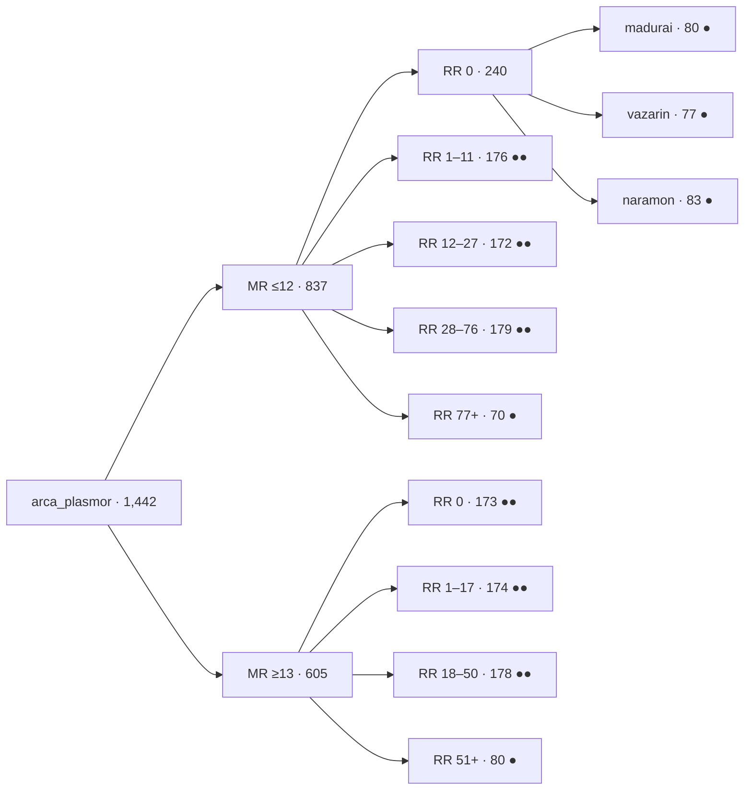
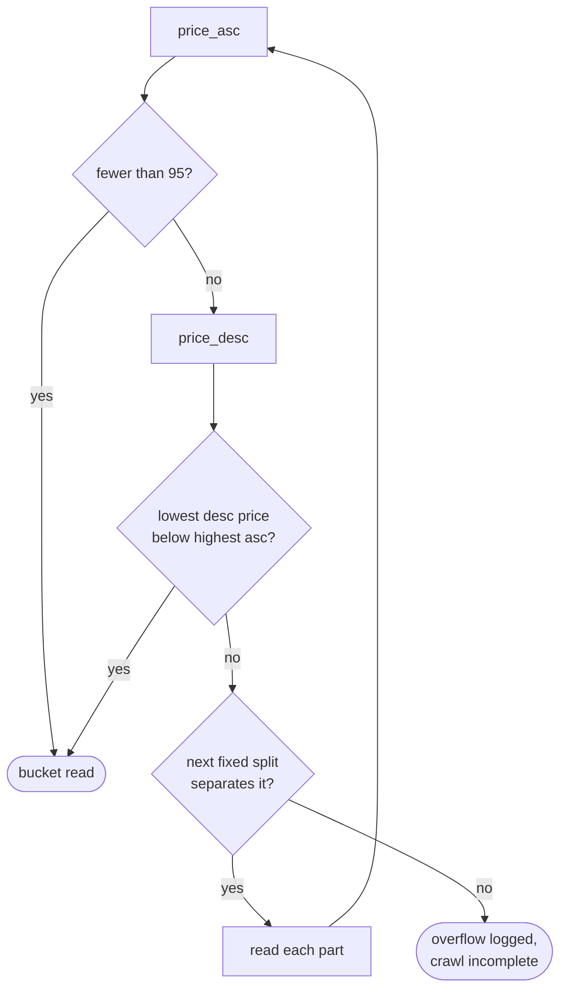

# Riven crawl plan

How the backend seeds and refreshes every weapon's riven listings with `/v1/auctions/search`. This
is step 4 of the [README](../README.md) plan. The API behaviour it relies on is measured in
[Crawling a weapon's full riven book](warframe-market-api.md#crawling-a-weapons-full-riven-book).

## Decisions

| Question | Decision |
| --- | --- |
| Seed and re-crawl | One loop. It always crawls the weapon crawled longest ago, never-crawled weapons first. |
| Cycle time | 5 h 50 m for all 420 weapons at the search rate limit, down from 11.4 h with fixed splits. `removed_at` has that resolution. |
| Removal confirmation | None. A listing missing from a complete crawl is marked removed. `/v1/auctions/entry/{id}` is not called, because the rate limit is the bottleneck. |
| False removals | Accepted. A listing seen again has its `removed_at` cleared. |
| Splits | Planned per weapon from its archived listings: mastery ranges, then re-roll ranges, then polarity. Fixed splits only break up a bucket that turns out bigger than planned. No negative-stat split. |
| Bucket that still overflows | Logged and left partly read. That weapon's removals are skipped for this crawl. |
| Weapon priority | None: plain round robin. Reweighting by volume or change rate would gain at most 10% (see [Measured](#measured)). Watched weapons may get priority once notification rules exist. |

## Measured

Fixed splits were measured over a 23-hour run on 2026-11-17 and replayed offline against the archive.
Planned buckets were measured from 13.5 hours of logs on 2026-11-20, plus the `removed_at` stamps
going back to the switch on 2026-11-17.

| | Fixed splits | Planned buckets |
| --- | --- | --- |
| Live listings | 187k | 185k |
| Requests a pass | 4,572 | 2,336 and 2,347 (modelled: 2,335) |
| Listings per request | 41 | 78 |
| Cycle time | 11.4 h | 5 h 50 m, and a median of 5.85 h on each day since the switch |
| Search pacing | Every 9 s, no `429`s | Same |
| Overflowing buckets | None | None |
| Failed crawls | 2 connection resets in 23 h | 1 connection reset in 13.5 h |
| Reappeared after removal | Not measured | 0.5% (seen again within two crawls) |

- 391 of 420 weapons send exactly the planned number of requests. Fallback splits cost about 2% of
  a pass, from about 6 weapons whose listings tie on price where the two pages meet. On embolist,
  the 78th to 100th cheapest listings are all 20p, so the strict check can't show that the two pages
  read the whole bucket. Search has no price filter that could settle a tie.
- No bucket grew past its plan between crawls. Planning to 90 and 190 would save 4.6% of requests,
  but 190 is more than two pages of 94 can hold.
- The largest re-roll bucket under fixed splits held 75 listings, so the negative-stat split isn't
  needed.
- The connection resets come from the warframe.market end partway through a response. The JDK client
  doesn't retry them, so the weapon waits for its next turn.
- Changes found per request don't depend on a weapon's size. Crawling each weapon in proportion to
  √(changes ÷ cost) instead of round robin would cut undetected changes by at most 10%.

## Loop

A scheduled task crawls one weapon per run and starts again 5 seconds after it finishes. The search
rate limiter does the pacing, so the task spends most of its time blocked on it.

1. Pick the weapon with the oldest `weapons.last_crawled_at`, nulls first.
2. Plan its buckets and read them (see below), archiving every page as it arrives through the same
   path the `/v1/auctions` poll uses.
3. If the whole book was read, mark the weapon's listings that weren't in it as removed.
4. Set `last_crawled_at`, whether or not the crawl succeeded.

A weapon whose crawl is cut short by a shutdown keeps the pages already archived and waits for its
next turn like any other failed crawl.

## Reading one weapon

A bucket is a set of search filters. The crawl plans buckets from what the archive already holds,
reads each one, and splits any that turns out bigger than planned.

### Planning

The weapon's live listings are counted by mastery level, re-rolls and polarity, which
`riven_auctions` holds. The book is then cut into buckets, picking the cuts that need the fewest
requests:

1. A book of up to 180 listings is one bucket.
2. Otherwise it's cut into contiguous mastery ranges. A range too big for one bucket, even one that
   spans several mastery levels, is cut into contiguous re-roll ranges. A single re-roll value too
   big for one bucket is cut by polarity.
3. A bucket of up to 85 listings costs one request, and up to 180 costs a pair. That leaves ~10%
   headroom below what one request (94) and a pair (~198) can read.

Cuts fall only at values in the book, and the first and last range of each filter are open-ended, so
the buckets cover every possible listing. A weapon with nothing archived yet gets one bucket for its
whole book, which the fixed splits below break up.

For example, arca_plasmor's 1,442 live listings on 2026-11-20 are planned as 11 buckets, read with 17
requests. `●` is one request (up to 85 listings) and `●●` is a `price_asc`/`price_desc` pair (up to
180):

### Reading a bucket

1. Request it sorted `price_asc`. Fewer than 95 results means that page is the whole bucket.
2. Otherwise request it sorted `price_desc`. If the lowest price on that page is strictly below the
   highest price on the `price_asc` page, the two pages are the whole bucket. A `null` buyout counts
   as infinitely expensive.
3. Otherwise split the bucket on the next filter below that separates it, narrowing it to each value
   in turn, and read each part the same way.

| Order | Filter | Values |
| --- | --- | --- |
| 1 | `mastery_rank_min`, `mastery_rank_max` | `≤8`, then `9` to `15` one each, then `16+` |
| 2 | `polarity` | `madurai`, `vazarin`, `naramon` |
| 3 | `re_rolls_min`, `re_rolls_max` | `0`, `1–3`, `4–10`, `11–25`, `26–60`, `61–150`, `151+` |

The mastery rank buckets are open-ended at both ends. Rivens in the game run from 8 to 16, but sellers
enter the level themselves, and some listings have 7.

A bucket that still overflows after all three splits holds more than ~200 listings with the same
mastery rank, polarity and re-roll band. Its two pages are kept, the rest is missed, and the crawl
counts as incomplete.

## Marking removals

After a crawl, a listing of that weapon gets `removed_at` set to the crawl's start time when all of
these hold:

- every bucket was read in full and no request failed
- the crawl returned at least one listing
- the listing has no `removed_at` yet and was not returned by the crawl
- the listing was created before the crawl started, so one the poll archived mid-crawl is left alone

Archiving a listing clears its `removed_at`. This undoes a false removal, which happens when a price
edit moves a listing across the page cutoff between the two requests of a pair. It also brings back
a listing its seller made private and then public again.

## Failures

Any failed request ends that weapon's crawl. Pages already read stay archived, no removals are
marked, and the weapon goes to the back of the queue. A `429` also pauses the search limiter for its
`Retry-After`, so the next weapon waits it out.

## Changes

- **Schema**: `weapons.last_crawled_at` and an index on `riven_auctions(weapon_id)`. The column is
  not mapped on the `Weapon` entity, because the manifest sync saves fresh entities and would reset
  it.
- **Rate limiting**: a search request takes a slot from the search limiter and then the general one,
  and a `429` on it pauses the search limiter only, so the poll and manifest sync keep running.
- **Scheduler**: two threads instead of one, so a crawl blocked on the limiter doesn't hold up the
  poll.
- **Client**: `GET /v1/auctions/search` with the filters as query parameters.
- **Planning**: one grouped query over the weapon's live listings, so no
  schema change. Each crawl logs how many requests it sent.

## Left out

- The negative-stat split. Add it if the overflow warning shows up in the logs.
- Crawling some weapons more often. Round robin is within 10% of the best reweighting.
- Re-reading each weapon's cheapest 100 listings between full crawls. That page holds 36% of the
  removals on books over 200, but a partial page can't tell a removal from a price raise. Revisit
  for cheap-riven alerts.
